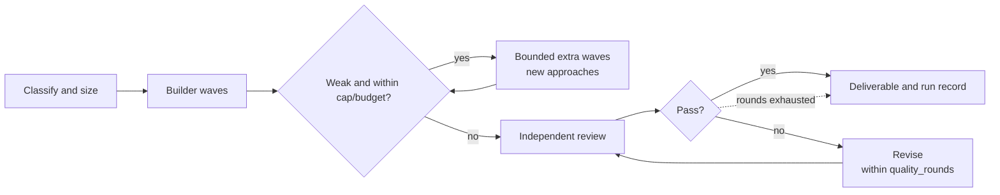

# CrewForeman
CrewForeman 3.7.0 is a local stdio MCP server that turns a brief into a supervised DeepSeek Harness run with sized waves, independent review and a saved record.
## Method
The connector classifies the brief, sizes the team, and plans waves at the child limit. The Harness lead runs each wave; the connector supervises it. It heuristically scores candidates 0–10 after each wave and schedules bounded extra waves for weak candidates within budget. An independent reviewer scores 0–10 and flags blocking defects; revision is bounded by `quality_rounds`.

## Outcomes

A run is accepted only at ≥8.5/10 with no blocking defect; `tries` is the configured `quality_rounds`, the rescue team is the finisher, and time or spending limits stop a run. See [docs/STATUS.md](docs/STATUS.md) for the status vocabulary.

**Skills that learn:** Tasks that fit no existing skill are captured, and when one recurs a new checklist is drafted, independently reviewed against the 8.5/10 bar, and promoted only after five uses with at least three scored runs if its median is within 0.3 of the baseline, its blocking rate rises by no more than 0.05, and it loses at most once. `auto_skills` = `auto` | `propose` | `off` (see [docs/skills.md](docs/skills.md)).

## Results

| Task | Agents / waves | Review score, first → final | Rounds | Wall time |
|---|---:|---:|---:|---:|
| Research: compare the connector with existing MCP tools | 8 / 1 | 8.0 → 9.0 | 3 | 4,424.8 s |
| Code: v3.3.0 root cause, finisher and agent selection | 4 / 1 | 8.2 → 8.7 | 2 | 4,311.3 s |

Two recorded runs, not a benchmark.

## Install

Python 3.9 or newer; no runtime dependencies. The separately installed DeepSeek Harness (`dsh`) is required; set `DSH_BIN` when it is not at the platform default.
```sh
python3 -m pip install .
crewforeman-mcp --help
```
Add a stdio server to the client's MCP configuration:
```json
{
  "mcpServers": {
    "crewforeman-mcp": {
      "command": "crewforeman-mcp",
      "env": { "DEEPSEEK_API_KEY": "YOUR_DEEPSEEK_API_KEY", "DSH_BIN": "/absolute/path/to/dsh" }
    }
  }
}
```
Call `harness_deepseek` with a prompt and workspace; a long run may return a job id to poll with `deepseek_job_status`.
## Guarantees
- Local stdio JSON-RPC; no hosted service, network listener or database. Tools include `consult_deepseek`, `harness_deepseek`, jobs and skills.
- Team sizing and exact waves at the detected child-concurrency limit.
- A single whole-job budget covers builder, reviewer, revisions, rescue and retries.
- Blocking review defects come with an ordered fix list before the next review.
- Every Harness run is saved as Markdown and JSON with token usage, estimated cost and the review trail; resume a killed run with `resume_deepseek`.
- Automatic skills are local, versioned and reversible; `auto_skills=off` restores the fixed five-skill behaviour.

## Limits
- macOS gets a best-effort Seatbelt file-write boundary; Linux and Windows rely on the Harness permission mode and the workspace convention. Not a network or process fence.
- Not an agent runtime or model provider; it requires `dsh` and a DeepSeek API key.
- Cost is a local estimate and drives an optional daily cap; unreadable logs leave it unknown.
- The reviewer is a model; its score is judgement, not proof of correctness.
- Run records and job files are plaintext; no multi-user authentication or encryption at rest.
- Skill detection and clustering are heuristic; a generated skill is reviewed but remains instructions for future runs, not executable code.

## Documentation

| Page | Contents |
|---|---|
| [Install](docs/INSTALL.md) | Requirements, install and client setup |
| [Operations](docs/OPERATIONS.md) | Configuration, safety, budgets, traces, retention |
| [Skills](docs/skills.md) | Registry, detection, lifecycle, automatic creation |
| [Status](docs/STATUS.md) | Run status vocabulary and precedence |
| [Limitations](docs/LIMITATIONS.md) | Known limitations and failure modes |
| [Clients](docs/CLIENTS.md) | Client configuration examples |

## License
MIT. See [LICENSE](LICENSE).
