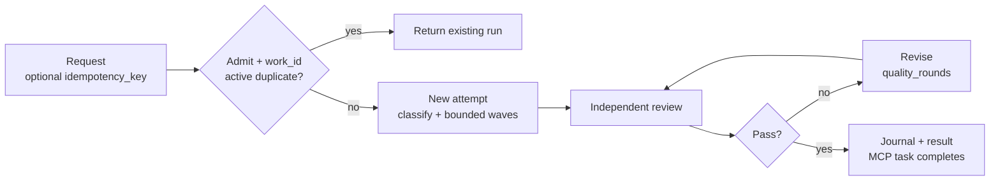
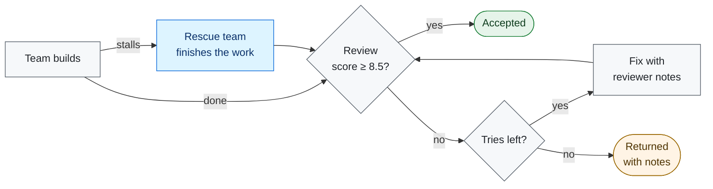

# CrewForeman

CrewForeman 3.9.2 is a local stdio MCP server. It runs Harness on your machine, sizes a team, builds in waves, has an independent reviewer score the result, and saves a record of every run.

## Roles
| Role | Who | What it does |
|---|---|---|
| Builder | Harness, configured by you | Sizes the team, builds in waves, revises on notes. |
| Independent reviewer | Any vendor, configured by you | Scores 0-10 and lists blocking defects. |
| Client / coordinator | Your MCP client | Sends the brief and reads the result. |

**Using a reviewer from a different vendor means a model never grades its own work.**
Use a reviewer from any vendor - see [docs/REVIEWER.md](docs/REVIEWER.md).

The lead sizes the team and merges the best candidates - see [docs/TEAMS.md](docs/TEAMS.md).

Runs survive restarts and can be resumed - see [docs/OPERATIONS.md](docs/OPERATIONS.md).

## Method
CrewForeman creates one work item for each brief. If the same work is already running, it returns that run. Otherwise it sizes a team and plans waves, up to the number of helper agents Harness allows in parallel. A reviewer scores the result from 0 to 10 and lists defects that block acceptance. `quality_rounds` caps the revisions.

## Outcomes

A run passes only at 8.5/10 or higher with no blocking defect. `quality_rounds` sets how many tries it gets. If the team stalls, a rescue team finishes the work. Time limits can stop a run. Accepted and returned outcomes update the journal and `result.json`. The MCP task completes only at a final state. See [docs/STATUS.md](docs/STATUS.md) for the status vocabulary.

**Skills that learn:** CrewForeman saves tasks that fit no existing skill. When a task recurs, it drafts a new checklist and has the reviewer check it against the 8.5/10 bar. A new skill is promoted only after five uses and at least three scored runs. Its median score must stay within 0.3 of the baseline. Its blocking-defect rate may rise by at most 0.05. It may lose at most one comparison against the baseline. `auto_skills` = `auto` | `propose` | `off` (see [docs/skills.md](docs/skills.md)).
## Quality
Recorded runs, not a benchmark. Scores are out of 10; blocking defects are in parentheses.

| Job | Builder self-score | Reviewer score by round (blocking defects) | Accepted |
|---|---:|---|---:|
| P2 | 9.0 | 4.0 (7) -> 6.0 (2) -> 7.5 (1) -> 8.5 (0) | 8.5 |
| P3 | 9.0 | 5.5 (3) -> 7.8 (1) -> 7.0 (3) -> 9.2 (0) | 9.2 |
| P3.1 | 9.5 | 7.8 (1) -> 7.0 (2) -> 9.3 (0) | 9.3 |
| P3.2 | 9.0 | 5.5 (4) -> 8.0 (1) -> 7.5 (2) -> 7.5 (1) -> 8.5 (0) | 8.5 |

Run ids: P2 20261106-060822-2c7805, 20261106-074319-1ce13c, 20261106-101017-5c89f5, 20261106-112259-1100ac; P3 20261106-163707-71e1d6, 20261106-184158-975632, 20261106-191907-52763d; P3.1 20261106-232057-3ec1b5, 20261106-235052-618469, 20261107-005306-0eb290; P3.2 20261107-074317-2fbe4e, 20261107-094604-5db916, 20261107-101818-b503dd.

## Convergence
One representative job (P3.2), round by round in its accepted run. Round 1 is a full review; round 2 re-checks what was flagged and the new changes.

| Round | What the reviewer checked | Review length | Score | Blocking defects |
|---:|---|---|---:|---:|
| 1 | Full review | Long | 7.5 | 1 |
| 2 | Flagged defects + new changes | Shorter | 8.5 | 0 |

Later rounds re-check only what was flagged, using test results the connector signed itself. Run id: 20261107-101818-b503dd.

## Install
Python 3.9 or newer; no runtime dependencies. The separately installed Harness (`dsh`) is required. Set `DSH_BIN` when it is not at the platform default.
```sh
python3 -m pip install .
crewforeman-mcp --help
```
Add the server to the client's MCP configuration:
```json
{"mcpServers": {"crewforeman-mcp": {"command": "crewforeman-mcp", "env": {"DEEPSEEK_API_KEY": "YOUR_DEEPSEEK_API_KEY", "DSH_BIN": "/absolute/path/to/dsh"}}}}
```
Call `harness_deepseek` with a prompt and a workspace. A long run may return a job id to poll with `deepseek_job_status`.

## Guarantees
- It runs locally over standard input/output (stdio) using JSON-RPC; there is no hosted service or network listener.
- Team size and exact waves follow the Harness child limit. One whole-job budget covers time and estimated cost for every phase.
- Every Harness run is saved as Markdown and JSON with token usage, estimated cost and the review trail. Resume a killed run with `resume_deepseek`.
- Blocking review defects come with an ordered fix list before the next review.
## Limits
- macOS gets a best-effort file-write boundary. Linux and Windows rely on the Harness permission mode and the workspace convention.
- The reviewer is a model. Its score is judgement, not proof of correctness. Run records are plaintext.
## Documentation
| Page | Contents |
|---|---|
| [Install](docs/INSTALL.md) | Requirements, install and client setup |
| [Reviewer](docs/REVIEWER.md) | Using a reviewer from another vendor |
| [Teams](docs/TEAMS.md) | How the agent team works |
| [Operations](docs/OPERATIONS.md) | Configuration, safety, budgets, traces, retention |
| [Skills](docs/skills.md) | Registry, detection, lifecycle, automatic creation |
| [Status](docs/STATUS.md) | Run status vocabulary and precedence |
| [Clients](docs/CLIENTS.md) | Client configuration examples |
| [Limitations](docs/LIMITATIONS.md) | Known limitations and failure modes |

## License
MIT. See [LICENSE](LICENSE).
