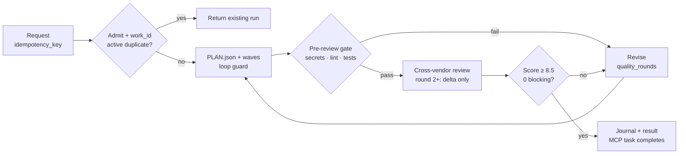
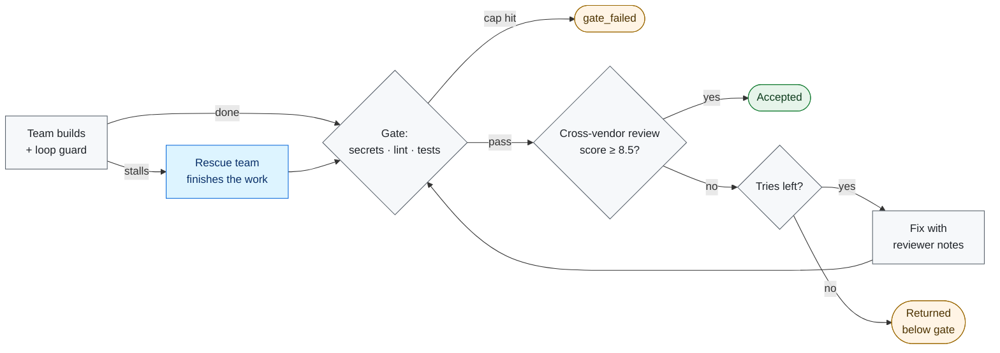

# CrewForeman

CrewForeman 3.14.1 is a local stdio MCP server. It runs Harness on your machine, sizes a team, builds in waves, has an independent reviewer score the result, and saves a record of every run.

## Roles
| Role | Who | What it does |
|---|---|---|
| Builder | Harness, any model (default DeepSeek) | Sizes the team, builds in waves, revises on notes. |
| Independent reviewer | Configurable, any vendor (e.g. Kimi) | Scores 0–10 and lists blocking defects. |
| Client / coordinator | Your MCP client (e.g. Claude) | Sends the brief and reads the result. |

**Using a reviewer from a different vendor means a model never grades its own work.**
Use a reviewer from any vendor - see [docs/REVIEWER.md](docs/REVIEWER.md).

The lead sizes the team and merges the best candidates - see [docs/TEAMS.md](docs/TEAMS.md).

## Method
CrewForeman creates one work item for each brief. If the same work is already running, it returns that run. Otherwise it sizes a team and plans waves, enforcing a deterministic gate (secrets, lint, tests) before any cross-vendor review.

## Outcomes

Runs update `result.json` and are saved locally. Terminal states update the MCP journal. See [docs/STATUS.md](docs/STATUS.md).

**Skills:** CrewForeman saves tasks that fit no existing skill. When a task recurs, it drafts a new checklist, reviewed against the 8.5/10 bar. A skill is promoted after five uses, median score within 0.3 of baseline, and blocking rate rise ≤0.05. (see [docs/skills.md](docs/skills.md)).

## Install
Python 3.9+; separately installed Harness (`dsh`) required.
```sh
python3 -m pip install .
crewforeman-mcp --help
```
Add to client configuration:
```json
{"mcpServers": {"crewforeman-mcp": {"command": "crewforeman-mcp",
  "env": {"DEEPSEEK_API_KEY": "...", "DSH_BIN": "/path/to/dsh"}}}}
```
## Guarantees
- Local JSON-RPC; no hosted service or network listener.
- Whole-job budget covers time and estimated cost for all phases.
- Blocking review defects provide an ordered fix list.
- Cross-vendor review; backup builder on auth/stream drop.
- Pre-review gate runs secrets, lint, tests; revision loops for failures.
- `PLAN.json` diff verification; deterministic loop guard catches no-change/ping-pong.
## Limits
- **Reviewer:** Model score is judgement, not proof of correctness.
- **Sandbox:** macOS (Seatbelt); Linux (Landlock); Windows (restricted token/ACE).
- **Metadata:** Records/jobs are plaintext; no user-authentication or encryption at rest.

## Documentation
| Page | Contents | Page | Contents |
|---|---|---|---|
| [Install](docs/INSTALL.md) | Setup | [Teams](docs/TEAMS.md) | Agent team |
| [Reviewer](docs/REVIEWER.md) | Vendor choice | [Operations](docs/OPERATIONS.md) | Budgets |
| [Skills](docs/skills.md) | Registry | [Status](docs/STATUS.md) | Vocabulary |
| [Clients](docs/CLIENTS.md) | Examples | [Limitations](docs/LIMITATIONS.md) | Modes |

## License
MIT. See [LICENSE](LICENSE).
