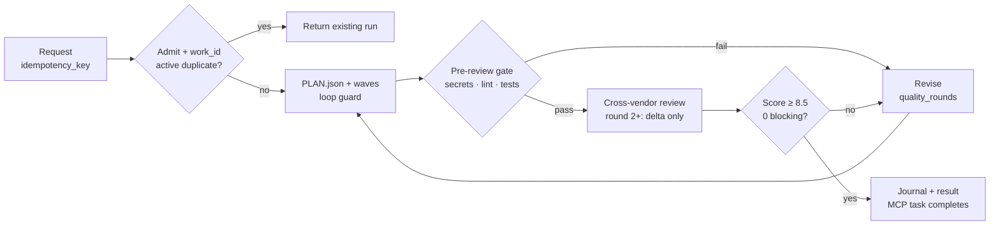

# CrewForeman [](https://github.com/StanyMwamba/crewforeman-mcp/actions/workflows/ci.yml)

CrewForeman 3.15.0 is a local stdio MCP server. It runs Harness on your machine, sizes a team, builds in waves, has an independent reviewer score the result, and saves a record of every run.

## Roles
| Role | Who | What it does |
|---|---|---|
| Builder | Harness, any model (default DeepSeek) | Sizes the team, builds in waves, revises on notes. |
| Independent reviewer | Configurable, any vendor (e.g. Kimi) | Scores 0–10 and lists blocking defects. |
| Client / coordinator | Your MCP client (e.g. Claude) | Sends the brief and reads the result. |

**Using a reviewer from a different vendor means a model never grades its own work.**
Use a reviewer from any vendor - see [docs/REVIEWER.md](docs/REVIEWER.md).
MiMo Code (`mimo`, v0.1.17) is a second-vendor worker: builder, independent reviewer or crosscheck crew - see [docs/TEAMS.md](docs/TEAMS.md).
Permissions, concurrency and per-vendor cost for MiMo runs are in [docs/OPERATIONS.md](docs/OPERATIONS.md).

The lead sizes the team and merges the best candidates - see [docs/TEAMS.md](docs/TEAMS.md).
Opt-in `mode="crosscheck"` builds independent parts with one crew and cross-checks each part with another; the connector scores the gate - see [docs/CROSSCHECK.md](docs/CROSSCHECK.md).
Jobs without a write set can run in parallel when the inferred sets are disjoint and confident - see [docs/PARALLEL.md](docs/PARALLEL.md).

## Method
CrewForeman creates one work item for each brief. If the same work is already running, it returns that run. Otherwise it sizes a team and plans waves, enforcing a deterministic gate (secrets, lint, tests) before any cross-vendor review.

## Outcomes

Runs update `result.json` and are saved locally. Terminal states update the MCP journal. See [docs/STATUS.md](docs/STATUS.md).

## Convergence
Recorded runs, not a benchmark. One representative job, round by round in its accepted run.

| Round | What the reviewer checked | Review length | Score | Blocking defects |
|---:|---|---|---:|---:|
| 1 | Full review | Long | 7.5 | 1 |
| 2 | Flagged defects + new changes | Shorter | 8.5 | 0 |

**Skills that learn:** CrewForeman saves tasks that fit no existing skill. When one recurs, it drafts a checklist, reviewed against the 8.5/10 bar, and promotes it only after five uses with a median within 0.3 of baseline and blocking-rate rise ≤0.05. `auto_skills` = `auto` | `propose` | `off` (see [docs/skills.md](docs/skills.md)).

## Install
Python 3.9+; separately installed Harness (`dsh`) required.
```sh
python3 -m pip install .
crewforeman-mcp --help
```
Add to client configuration:
```json
{"mcpServers": {"crewforeman-mcp": {"command": "crewforeman-mcp",
  "env": {"DEEPSEEK_API_KEY": "...", "DSH_BIN": "/path/to/dsh"}}}}
```
## Guarantees
- Local JSON-RPC; no hosted service or network listener.
- Whole-job budget covers time and estimated cost for all phases.
- Blocking review defects provide an ordered fix list.
- If the reviewer's service fails, a backup reviewer from another vendor takes over, and a quota error names that reviewer's vendor and model, never DeepSeek.
- Cross-vendor review; backup builder on auth/stream drop.
- Pre-review gate runs secrets, lint, tests; revision loops for failures.
- `PLAN.json` diff verification; deterministic loop guard catches no-change/ping-pong.
- Bounded failure notes decay into the next builder prompt; a disjoint queued job with a declared write-set installs its patch only after `git apply --check` passes.
- Every Harness run is saved as Markdown and JSON with token usage, estimated cost and the review trail.
## Limits
- **macOS:** Seatbelt; writes outside the workspace are denied, while reads and network are unrestricted.
- **Linux:** Landlock ABI 3+; `UNSANDBOXED` when no boundary, `require` refuses, ABI 1-2 degraded.
- **Windows:** write-restricted token plus workspace/temp ACE; `delete_outside=unverified` unless proven.
- **Reviewer & data:** Model score is judgement, not proof of correctness; run records and job files are plaintext, with no user authentication or encryption at rest.

## Documentation
| Page | Contents | Page | Contents |
|---|---|---|---|
| [Install](docs/INSTALL.md) | Setup | [Teams](docs/TEAMS.md) | Agent team |
| [Reviewer](docs/REVIEWER.md) | Vendor choice | [Operations](docs/OPERATIONS.md) | Budgets |
| [Skills](docs/skills.md) | Registry | [Status](docs/STATUS.md) | Vocabulary |
| [Clients](docs/CLIENTS.md) | Examples | [Limitations](docs/LIMITATIONS.md) | Modes |

## License
MIT. See [LICENSE](LICENSE).
