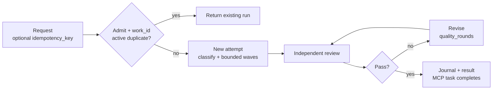

# CrewForeman
You send a brief; CrewForeman sizes a team, builds in waves, has an independent reviewer score the result, and revises until it passes or runs out of tries.
CrewForeman 3.8.1 is a local stdio MCP server. It runs DeepSeek Harness on your machine and saves a record of every run.
## Roles
| Role | Who | What it does |
|---|---|---|
| Builder | DeepSeek Harness (default) | Sizes the team, builds in waves, revises on notes. |
| Independent reviewer | Configurable, any vendor (e.g. Kimi) | Scores 0–10 and lists blocking defects. |
| Client / coordinator | Your MCP client (e.g. Claude) | Sends the brief and reads the result. |

Using a reviewer from a different vendor avoids a model grading its own work.

No separate reviewer model setting ships. The reviewer runs the same `dsh_bin` (`DSH_BIN`) as the builder. CrewForeman gives each review run a private `DSH_HOME` under `<state_dir>/reviewer-homes/`.

Point `DSH_BIN` at a wrapper that checks `DSH_HOME` (the private review home). On a review run, the wrapper can load a patch that selects another vendor's model. On other runs, it calls `dsh` unchanged. `dsh_provider` and `dsh_model` are shared, so changing them changes the builder too.

A working Kimi example is the operator wrapper `dsh-reviewer-kimi.sh` plus `reviewer-kimi.patch.yml`. Set the `dsh` path and patch path inside the script, then point `DSH_BIN` at it. These files are operator examples, not package settings.
## Method
CrewForeman creates one work item for each brief. If the same work is already running, it returns that run. Otherwise it sizes a team and plans waves, up to the number of helper agents Harness allows in parallel. A reviewer scores the result from 0 to 10 and lists defects that block acceptance. `quality_rounds` caps the revisions.

## Outcomes

A run passes only at 8.5/10 or higher with no blocking defect. `quality_rounds` sets how many tries it gets. If the team stalls, a rescue team finishes the work. Time limits can stop a run. Accepted and returned outcomes update the journal and `result.json`. The MCP task completes only at a final state. See [docs/STATUS.md](docs/STATUS.md) for the status vocabulary.

**Skills that learn:** CrewForeman saves tasks that fit no existing skill. When a task recurs, it drafts a new checklist and has the reviewer check it against the 8.5/10 bar. A new skill is promoted only after five uses and at least three scored runs. Its median score must stay within 0.3 of the baseline. Its blocking-defect rate may rise by at most 0.05. It may lose at most one comparison against the baseline. `auto_skills` = `auto` | `propose` | `off` (see [docs/skills.md](docs/skills.md)).
## Results
| Task | Agents / waves | Review score, first → final | Rounds | Wall time |
|---|---:|---:|---:|---:|
| Research: compare the connector with existing MCP tools | 8 / 1 | 8.0 → 9.0 | 3 | 4,424.8 s |
| Code: v3.3.0 root cause, finisher and agent selection | 4 / 1 | 8.2 → 8.7 | 2 | 4,311.3 s |

Two recorded runs, not a benchmark.
## Install
Python 3.9 or newer; no runtime dependencies. The separately installed DeepSeek Harness (`dsh`) is required. Set `DSH_BIN` when it is not at the platform default.
```sh
python3 -m pip install .
crewforeman-mcp --help
```
Add the server to the client's MCP configuration:
```json
{
  "mcpServers": {
    "crewforeman-mcp": {
      "command": "crewforeman-mcp",
      "env": { "DEEPSEEK_API_KEY": "YOUR_DEEPSEEK_API_KEY", "DSH_BIN": "/absolute/path/to/dsh" }
    }
  }
}
```
Call `harness_deepseek` with a prompt and a workspace. A long run may return a job id to poll with `deepseek_job_status`.

## Durable work
- `harness_deepseek` accepts `idempotency_key`. Retries with the same key share one work item. After that work ends, a new request starts a new attempt. `dedupe_active` (default `true`, `DSH_DEDUPE_ACTIVE`) merges identical requests only while they are active.
- Work files live under `<state_dir>/work/<work_id>/`: `attempts.jsonl`, `events.jsonl` and `result.json`.
- To follow a run, call `deepseek_job_status` with `run_id` and `events_since=0`, then pass the returned `next_seq` back as `events_since`. The reply adds new events, `stage`, `attention`, any pending `question` and `options`, `next_action`, `terminal` and `result`. An older `events_since` value receives retained events, not an error.
- `task_completion="job"` (default) keeps the MCP task `working` until a final journal state. A pending question in one fenced `attention` JSON block (`question`, `options`, optional `evidence`) makes it `input_required`. `task_completion="request"` completes when the call returns.

## Guarantees
- It runs locally over standard input/output (stdio) using JSON-RPC. There is no hosted service, network listener or database. Tools include `consult_deepseek`, `harness_deepseek`, jobs and skills.
- Team size and exact waves follow the limit on parallel helper agents. One whole-job budget covers time and estimated cost for every phase. An optional daily cap applies across jobs.
- Blocking review defects come with an ordered fix list before the next review.
- Every Harness run is saved as Markdown and JSON with token usage, estimated cost and the review trail. Resume a killed run with `resume_deepseek`.

## Limits
- macOS gets a best-effort file-write boundary. Linux and Windows rely on the Harness permission mode and the workspace convention. It does not restrict network access or processes.
- Not an agent runtime or model provider. It needs `dsh` and a DeepSeek API key.
- The reviewer is a model. Its score is judgement, not proof of correctness.
- Run records and job files are plaintext, with no multi-user authentication or encryption at rest. Skill detection is heuristic. A generated skill is instructions for future runs, not executable code.

## Documentation
| Page | Contents |
|---|---|
| [Install](docs/INSTALL.md) | Requirements, install and client setup |
| [Operations](docs/OPERATIONS.md) | Configuration, safety, limits, traces, retention |
| [Skills](docs/skills.md) | Registry, detection, lifecycle, automatic creation |
| [Status](docs/STATUS.md) | Run status vocabulary and precedence |
| [Limitations](docs/LIMITATIONS.md) | Known limitations and failure modes |
| [Clients](docs/CLIENTS.md) | Client configuration examples |

## License
MIT. See [LICENSE](LICENSE).
