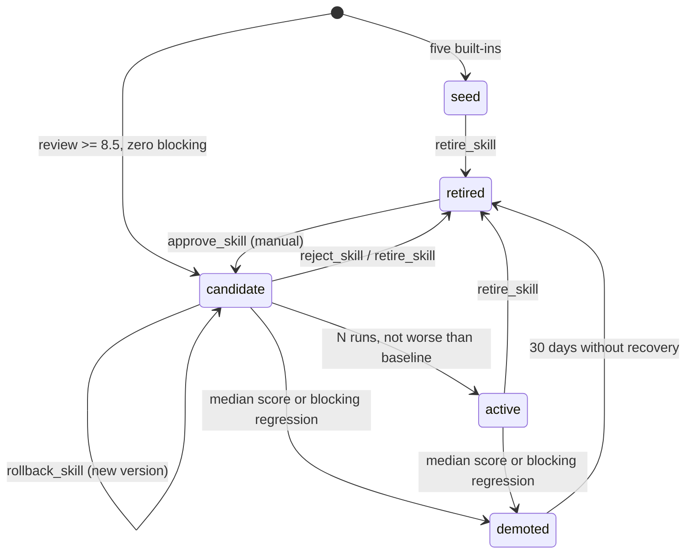

# Skills

A skill is a short Markdown checklist that the connector injects into a Harness
builder task. It is guidance, not a sandbox: the quality contract, the
independent review and the configured permission preset still apply. Five
skills ship as seeds — `poster`, `document`, `web`, `code` and `data` — and,
from CrewForeman 3.7.0, the connector can author, review, trial,
promote and retire its own.

This page describes the automatic skill system in 3.7.0. If a config key or
output differs, the code and `config.example.json` win.

## What is a skill

A skill is a Markdown file (`<skills_dir>/<key>.md`) with a title, a checklist
and a `## Lessons learned` section. The connector passes the file to the
builder under `## Skill checklist: <title>`. It is not a prompt template, not a
tool and not a plugin: it is reusable advice for a class of tasks. Treat a
skill like code — review it before trusting it, because it becomes instructions
for future runs.

Each skill has a canonical key (`^[a-z][a-z0-9-]{1,31}$`), a title, aliases,
keywords, a task type (`code`, `research`, `creative` or `document`), a status,
a version and statistics. `simple` is a skip signal only and is never stored as
a task type.

## The registry

```
<skills_dir>/
  index.json                    registry (authoritative, schema 1)
  index.json.bak                previous index (from the 2nd save)
  <key>.md                      current checklist
  .versions/<key>/v0001.md      immutable version content
  .versions/<key>/v0001.json    version metadata
  .capture/unmatched.jsonl      sanitised unmatched signatures
  .capture/clusters.json        cluster state and baselines
  .capture/decisions.jsonl      audit of every automatic decision
  .locks/registry.lock          short-lived writer lock
```

`<skills_dir>` comes from the config when set; otherwise the connector uses a
writable checkout or installed `share/` directory, or `<state_dir>/skills`
seeded from the shipped files. An explicit `skills_dir` that is not writable is
used read-only with a warning; the connector does not silently move it.

The registry records lifecycle and statistics; the Markdown file is the content
that is injected. The five seed files are never rewritten by migration.
Generated files begin with an HTML-comment metadata block:

```markdown
<!-- skill-meta
{"schema":1,"key":"newsletter","title":"Newsletter / email campaign",
 "aliases":["email-newsletter"],"keywords":["newsletter","email campaign"],
 "task_type":"creative","status":"candidate","version":1,
 "source":"generated"}
-->

# Newsletter / email campaign

...
```

The block is invisible in a rendered document and is stripped before
injection. It lets a generated skill be recovered if `index.json` is lost.
Seeds are recovered from the built-in table.

`index.json` is capped at 512 KiB and 64 non-retired skills. When the cap is
reached, `save()` drops warnings, lesson samples, old stats window/recent
entries, non-seed history and old cluster builds first; it never drops a seed
v1 entry or its `.versions` files. A missing index is migrated once. A corrupt
index is copied to `index.corrupt-<timestamp>.json` (keep two), restored from
`.bak` when a previous generation exists, and otherwise rebuilt from version
metadata, front-matter, headings and the seed table. All writes are temp-file
plus `os.replace`, guarded by a short-lived lock; a busy registry never blocks
a run.

`index.json.bak` is the index bytes that were on disk immediately before the
most recent save, so it is the previous generation, not a copy of the new one.
There is no `.bak` after the very first save; recovery then rebuilds from the
version files and headings. A content change is written version content ->
version metadata -> index -> live `<key>.md`. That multi-file sequence is not
one transaction; if a later step fails, the recorded version remains the source
of truth for `read_skill` and the next rollback.

Hand-editing a seed or generated `<key>.md` is supported: the next load adopts
valid front-matter and the next successful change snapshots the bytes as a new
version. Do not edit `index.json` while a run is active. To force a rebuild
from files, stop the server, remove `index.json` (keep `.versions/`) and call
`list_skills`.

## Detection and unmatched

For each injectable skill the connector scores keyword and alias matches:
multi-word keyword `+3`, single keyword `+1`, alias `+2`, and a `+1` key/title
bonus when the prompt contains a task verb. Duplicate words count once.

```
strength   = min(1.0, best / 8.0)
separation = 1.0 if second == 0 else max(0.0, (best - second) / best)
confidence = 0.5 * strength + 0.5 * separation
```

The result is `unmatched` when the best raw score is below
`auto_skills_min_score` (2), when confidence is below
`auto_skills_min_confidence` (0.55), or when the top-two margin is below
`auto_skills_tie_margin` (0.10). A tie is deliberately unmatched instead of
being forced into the first skill in a list. This is the core change from
3.6.0: unfamiliar work is captured, not squeezed.

Examples (default settings):

| Prompt | Scores | Confidence | Selected |
|---|---|---|---|
| `Design a print poster with a QR code` | poster 8, code 2 | 0.875 | poster |
| `Write a cover letter for a job` | document 5, poster 1 | 0.713 | document |
| `Build a responsive HTML web page` | web 6, code 1 | 0.792 | web |
| `make a poster` | poster 2 | 0.625 | poster |
| `what is data?` | data 1 | below min score | unmatched |
| `poster or web?` | poster 1, web 0 | below min score | unmatched |
| `code and data analysis` | data 2, code 1 | 0.375 | unmatched |
| `write a python cli with tests` | code 3 | 0.688 | code |

To force a skill, pass `skill="<key-or-alias>"` to `harness_deepseek`; to
disable injection for one run, pass `skill="none"`. An explicit skill bypasses
confidence but still must exist. The run record stores
`skill_match: {key, confidence, runner_up, status, unmatched, threshold}`.
When `auto_skills="off"` the field is absent, exactly as in 3.6.0.

## Lifecycle



| Status | Injected? | Meaning |
|---|---|---|
| `seed` | yes | One of the five built-ins; may be refreshed, demoted or manually retired |
| `active` | yes | Earned its place with measured runs |
| `candidate` | yes, once `approved` | Accepted draft on trial; `propose` mode leaves it unapproved until a human approves |
| `demoted` | no | Hurt scores; kept and readable, can be manually re-approved |
| `retired` | no | Removed from selection; content and versions remain for rollback |

A candidate is promoted after `auto_skills_promote_after` runs (default 5)
with at least three scored runs whose **median** review score is not worse than
the frozen `stats.baseline_ref` median minus `auto_skills_score_tolerance`
(0.3), provided the blocking rate has not risen by more than 0.05 and at most
one run was a loss. If `baseline_ref` is null (fewer than three unmatched runs),
promotion is held; the connector does not invent one.

No demotion is evaluated before `auto_skills_demote_after` uses (default 3).
After that, a skill is demoted when the median of its last 20 scored runs is
more than 1.0 below the baseline at use, when two consecutive runs are bad, or
when its blocking rate is more than 0.15 above the baseline. A demoted skill is
retired after `auto_skills_retire_after_days` (default 30) without recovery
(approval, a successful refresh or a rollback); it is not injected, so it
cannot accumulate more automatic runs. Built-ins are not auto-retired for
inactivity.

## Automatic creation

1. **Capture.** An unmatched terminal run contributes a privacy-safe
   signature: up to 12 lowercase tokens, task type, deliverable kinds, size
   bucket, best match, outcome, review score, blocking count, defect/fix kinds
   and optionally short sanitised samples. The raw prompt, title, workspace,
   filenames and paths are never stored.
2. **Cluster.** Signatures join a cluster when the task type matches and the
   weighted keyword/deliverable similarity is at least
   `auto_skills_cluster_similarity` (0.62). The default trigger is three
   similar runs. If a run is severe (failed status, two or more blocking
   defects, score <= 6.0, a write violation, or a severe defect kind), two runs
   are enough; one run needs `auto_skills_allow_single_severe=true`.
3. **Author.** One bounded Harness agent in a read-only scratch workspace
   receives the sanitised evidence (nonce-fenced, labelled as data), the
   existing registry summary and a strict JSON schema. It returns a draft: key,
   title, aliases, keywords, description, task type, 6–20 concrete checklist
   items with sections, and 0–8 lessons. The draft must echo the evidence
   digest; invented support is rejected.
4. **Resolve and validate.** Duplicate detection runs first and decides whether
   the draft is a `create` or a `merge` into an existing entry, including a
   seed. A key or alias collision is a merge signal, not a validator error. The
   deterministic validator then checks the contract for that action: key,
   aliases, keyword discrimination, checklist count and phrasing, a
   verification item, an edge-case item, PII/URLs/secrets, prompt-injection
   patterns, size, and the evidence binding (for a merge: 1–6 additive items,
   an unchanged existing body and a reviewed preview). Any blocking error means
   no review and no save.
5. **Review.** A **fresh** Harness reviewer, read-only and in a new session,
   scores the draft 0–10 against the evidence and the registry. It returns
   `{score, blocking_defects, non_blocking_defects, fixes, verdict}`. The draft
   is saved only at **8.5 or higher with zero blocking defects and a `pass`
   verdict**. Otherwise the author revises with the fix list, up to two revision
   rounds (three attempts total), then the draft is discarded.
6. **Save or merge.** An accepted draft becomes a versioned `candidate` and is
   injected immediately in `auto` mode. If it is too close to an existing
   skill — or its key/alias exactly matches one, including a seed — it is
   merged into that skill as aliases, keywords, lessons and additive checklist
   items instead of creating a duplicate; the merged preview goes through the
   same review. Merging into a seed keeps `source: "builtin"` and bumps its
   version.

The whole loop is bounded by per-call timeouts (180 s author, 120 s reviewer),
a 360 s build budget, at most one build per run and four per UTC day, and a
cost cap (`auto_skills_max_cost_usd`, default 1.00). A timeout, a malformed
JSON response, a missing digest or a cost cap is a failed attempt, never a
raised exception. A failed or budget-exhausted cluster stays `ready` and is
retried after `auto_skills_cluster_cooldown_hours` (default 24).

## Configuration

All keys live in the config file or the environment (`DSH_*` wins over the
legacy `DEEPSEEK_*` alias when both are set).

| Key | Type | Default | Env | Effect |
|---|---|---|---|---|
| `auto_skills` | enum | `auto` | `DSH_AUTO_SKILLS`, `DEEPSEEK_AUTO_SKILLS` | `auto`, `propose` or `off` |
| `auto_skills_min_confidence` | float | `0.55` | `DSH_AUTO_SKILLS_MIN_CONFIDENCE` | Detection threshold |
| `auto_skills_min_score` | float | `2` | — | Minimum raw score |
| `auto_skills_tie_margin` | float | `0.10` | — | Ambiguity margin |
| `auto_skills_cluster_min` | int | `3` | `DSH_AUTO_SKILLS_CLUSTER_MIN` | Normal cluster size |
| `auto_skills_cluster_min_severe` | int | `2` | `DSH_AUTO_SKILLS_SEVERE_MIN` | Severe cluster size |
| `auto_skills_reviewed_min` | int | `2` | — | Reviewed members before a normal draft |
| `auto_skills_allow_single_severe` | bool | `false` | — | One severe run may draft |
| `auto_skills_cluster_similarity` | float | `0.62` | — | Join threshold |
| `auto_skills_capture_limit` | int | `500` | — | Records before rotation |
| `auto_skills_max_keywords` | int | `12` | — | Tokens per signature |
| `auto_skills_capture_explicit_none` | bool | `false` | — | Capture `skill="none"` |
| `auto_skills_max_clusters` | int | `50` | — | Live clusters |
| `auto_skills_cluster_max_age_days` | int | `90` | — | Archive a collecting cluster |
| `auto_skills_max_members` | int | `20` | — | Members per cluster |
| `auto_skills_quality_gate` | float | `8.5` | `DSH_AUTO_SKILLS_GATE` | Reviewer gate |
| `auto_skills_review_rounds` | int | `2` | `DSH_AUTO_SKILLS_REVIEW_ROUNDS` | Revisions after the first review |
| `auto_skills_author_seconds` | float | `180` | — | Per author call |
| `auto_skills_review_seconds` | float | `120` | — | Per reviewer call |
| `auto_skills_build_seconds` | float | `360` | — | Whole build budget |
| `auto_skills_max_drafts_per_run` | int | `1` | — | Inline builds |
| `auto_skills_max_drafts_per_day` | int | `4` | — | Daily builds (UTC) |
| `auto_skills_max_cost_usd` | float | `1.0` | — | Build cost cap; 0 disables builds |
| `auto_skills_cluster_cooldown_hours` | float | `24` | — | Retry backoff |
| `auto_skills_promote_after` | int | `5` | `DSH_AUTO_SKILLS_PROMOTE_AFTER` | Uses before promotion |
| `auto_skills_demote_after` | int | `3` | — | Minimum uses before demotion is considered |
| `auto_skills_retire_after_days` | int | `30` | — | Demoted-to-retired timeout |
| `auto_skills_score_tolerance` | float | `0.3` | — | Not-worse margin |
| `auto_skills_dedup_threshold` | float | `0.55` | — | Merge threshold |
| `auto_skills_max_skills` | int | `64` | — | Non-retired skills |
| `auto_skills_max_candidates` | int | `8` | — | Unpromoted candidates |
| `auto_skills_max_skill_chars` | int | `24000` | — | Skill size cap |
| `auto_skills_max_versions` | int | `10` | — | Retained non-seed versions; seed v1 is always kept |
| `auto_skills_refresh` | bool | `true` | — | Checklist refresh |
| `auto_skills_refresh_after` | int | `3` | — | Repeated lessons needed |
| `auto_skills_refresh_cooldown_days` | float | `7` | — | Refresh backoff |
| `auto_skills_store_evidence_text` | bool | `false` | — | Opt in to sanitised samples |

Invalid `auto_skills` values fail at config load with the allowed values.
Numeric ranges are clamped with a warning where a clamp is safe; the quality
gate outside 0–10 fails at load and `auto_skills_max_skill_chars < 4000`
clamps to 4000.

## MCP tools

The six skill tools are part of the 20-tool server surface. In `off` mode the
four write tools refuse the call and change nothing.

### `list_skills`

```
list_skills(status="all"|"seed"|"active"|"candidate"|"demoted"|"retired",
            format="text"|"json")
```

```json
{"skills": [{"key": "newsletter", "status": "candidate", "version": 1,
             "uses": 2, "median_score": 8.7, "baseline": 8.1,
             "approved": false, "cluster_id": "c-1a2b3c4d5e"}],
 "count": 1}
```

Text output is grouped by status and shows version, uses, median score,
baseline, delta and cluster. `format="json"` returns entry metadata without the
full content. `list_skills` may create `index.json` on first use in `auto` or
`propose` mode; in `off` it returns the read-only seed view.

### `read_skill`

```
read_skill(name="newsletter", version=1, meta=false)
```

```json
{"key": "newsletter", "version": 1, "status": "candidate",
 "content": "# Newsletter / email campaign\n\n- ...", "chars": 842}
```

Reads the current content (front-matter stripped) or a historical version.
`meta=true` adds status, version, statistics and review metadata. Unknown
names list up to 20 known keys; missing versions list the available ones.

### `approve_skill`

```
approve_skill(name="newsletter", note="reviewed by the content team")
```

```json
{"key": "newsletter", "status": "candidate", "approved": true,
 "note": "reviewed by the content team"}
```

Approves a `propose`-mode candidate so it becomes injectable. It stays a
candidate on trial; promotion to `active` still needs the measured runs.
Approving a demoted or retired skill starts a new trial.

### `reject_skill`

```
reject_skill(name="newsletter", reason="too close to document")
```

```json
{"key": "newsletter", "status": "retired",
 "retired_reason": "too close to document"}
```

Retires the candidate and records the reason. Content and versions remain
readable.

### `retire_skill`

```
retire_skill(name="newsletter", reason="superseded")
```

```json
{"key": "newsletter", "status": "retired", "retired_reason": "superseded"}
```

Stops injection for any non-retired skill (seed, active, candidate or
demoted). It does not delete the file or history.

### `rollback_skill`

```
rollback_skill(name="poster", version=1)
```

```json
{"key": "poster", "from_version": 2, "to_version": 3,
 "restored_from": 1, "status": "seed"}
```

Restores a previous version as a **new** version (history is never rewritten),
verifies the target checksum, and puts a generated skill back on trial
(`candidate`) or a seed back to `seed`. The response gives the old, new and
restored version numbers.

In `off` mode the write tools return
`auto_skills is off; set DSH_AUTO_SKILLS to auto or propose` and change
nothing.

## Privacy

- Unmatched capture stores tokens, not prompts. PII (emails, bearer/API keys,
  JWTs, private keys, URLs, POSIX/Windows home paths, IPs, phones, handles) is
  removed before tokenising.
- Probable proper nouns are dropped at any position, including the first word
  of a sentence: a word that only ever appears capitalised is stored only when
  it is on a small explicit common-word/task-verb/tech allowlist. `Jordan
  needs a launch poster` therefore never stores `jordan`; the other safe
  tokens may remain.
- Defect/fix samples are off by default. Set
  `auto_skills_store_evidence_text=true` to opt in to sanitised samples,
  capped at 200 characters and three per record and labelled as untrusted data
  in the author prompt; otherwise only defect/fix kinds are stored.
- No prompt, filename, workspace path or file content is written to the
  registry, capture, cluster, decision log or trace.
- Errors are passed through the connector's secret redaction before being
  stored.

Residual risk: free-text redaction is heuristic. A lowercase name or an
unusual identifier inside a review sample could survive. Keep
`auto_skills_store_evidence_text=false` (the default) for kinds only, and use
`auto_skills="propose"` when a human must see every candidate first.

## Rollback, merge and refresh

**Rollback.** Every accepted change writes an immutable version.
`rollback_skill` reads the target, verifies its checksum, writes it as a new
version and updates the live file. A writable migration snapshots each present
seed as version 1; on the explicit read-only seed view there is no version file
and rollback returns a clear read-only error. A fresh generated skill has no
previous version: rollback becomes available after the first accepted change
writes version 2. The newest 10 non-seed versions are kept (plus seed v1, which
is never pruned); a pruned target returns an actionable error instead of
guessing. Status after rollback follows one rule: a built-in returns to `seed`,
a generated/imported skill returns to `candidate` with `approved` preserved;
`status_at_version` is audit only. A generated rollback re-freezes the current
task-type baseline (or `null`, which holds promotion) so the candidate can
re-earn `active`.

**Merge.** A draft whose keyword/alias overlap is at or above
`auto_skills_dedup_threshold`, whose synthetic prompt is classified to an
existing skill, or whose key/alias exactly matches one (seed included), is not
saved as a new file. Its aliases (cap 12), keywords (cap 30), lessons (up to 8)
and up to six additive checklist items are merged into the existing skill, the
merge preview is reviewed, and a new `reason="merge"` version is written. A key
or alias collision always merges; it never creates `-2` variants and is never
rejected as a validator error. A no-op merge writes nothing.

**Refresh.** `note_lesson` hashes every lesson and increments a counter even
when the bullet is a near-duplicate. When a lesson repeats
`auto_skills_refresh_after` times (default 3), the skill is eligible for a
refresh: an author proposes 1–6 additive checklist items and 0–3 lessons, the
validator checks the additions, PII/injection, no destructive edit and the
preview, then a fresh reviewer applies the same 8.5/zero-blocking gate. On
acceptance the items are inserted under the matching section (or under
`## Learned checks (auto)`) and a new version is written; on rejection the
original bytes are unchanged and the attempt backoff increases. The built-in
five refresh exactly like generated skills.

## Migration from 3.6.0

The first `auto`/`propose` run or `list_skills` creates `index.json` from the
five seeds. It does not rewrite the five Markdown files or their lessons. An
unknown top-level `*.md` with a valid name and a `#` heading is adopted as an
active, imported skill; an invalid file is skipped and recorded in
`warnings`, never deleted or rewritten. If the default skills directory is
read-only, the connector copies the shipped files to `<state_dir>/skills` once
(never overwriting) and uses that writable fallback; an **explicit**
`skills_dir` that is read-only is honoured as read-only, returns the seed view
and writes nothing. Existing `list_skills`/`read_skill` calls keep working; the
new fields are additive. Setting `auto_skills="off"` restores 3.6.0 behaviour
without deleting anything.

## Troubleshooting

| Symptom | Cause and fix |
|---|---|
| `registry_busy` / `contended` in a run | Another process holds the lock; the run continues. Retry later; do not delete the lock while a process is alive. A stale lock is broken after 60 s or when its owner pid is dead. |
| `index.json` corrupt | The connector keeps `index.corrupt-<ts>.json`, restores `.bak` when a previous generation exists, then rebuilds. To force a rebuild, remove `index.json` (keep `.versions/`) and call `list_skills`. |
| Read-only skills directory | Set `skills_dir` to a writable path, or let the default install fall back to `<state_dir>/skills`. An explicit read-only `skills_dir` stays read-only on purpose. |
| Candidate not injected | Check `approved`; in `propose` mode run `approve_skill`. A demoted/retired candidate is not injected. |
| Reviewer keeps rejecting | Read the run record and `.capture/decisions.jsonl`; the validator codes and reviewer fixes say what to change. After the revision cap the cluster backs off. |
| No promotion | A baseline needs at least three unmatched runs; check `list_skills format=json` for `baseline_ref`. Promotion also needs five uses and three scored runs. |
| No capture | The run matched a skill, used an explicit `skill=`, was `off`, was classified `simple`, or had too few safe tokens. |
| `auto_skills` error at startup | Use `auto`, `propose` or `off`; the message lists the allowed values. |

## Limitations

- Confidence and clustering are lexical heuristics; paraphrases and non-English
  prompts may stay unmatched or form separate clusters.
- The reviewer is an LLM. The deterministic validator, the fresh session, the
  digest binding and the post-promotion statistics are the safety net, not a
  proof of correctness.
- Free-text sample redaction is conservative but not perfect; samples are off
  by default, so leave them off for privacy-maximal deployments.
- Skills are local to the configured `skills_dir`; there is no cross-machine
  sync and no marketplace.
- A skill is prompt content. A malicious accepted skill could influence future
  runs; use `propose` mode and review the diff like code.
